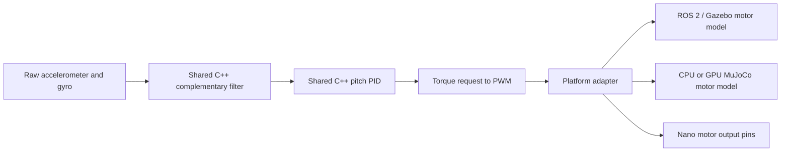
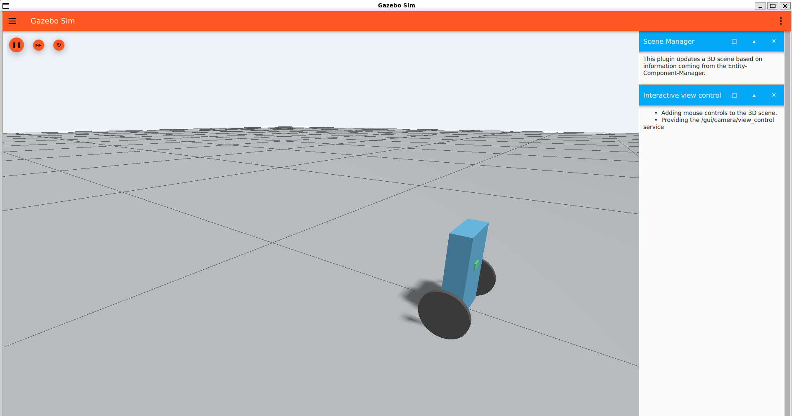
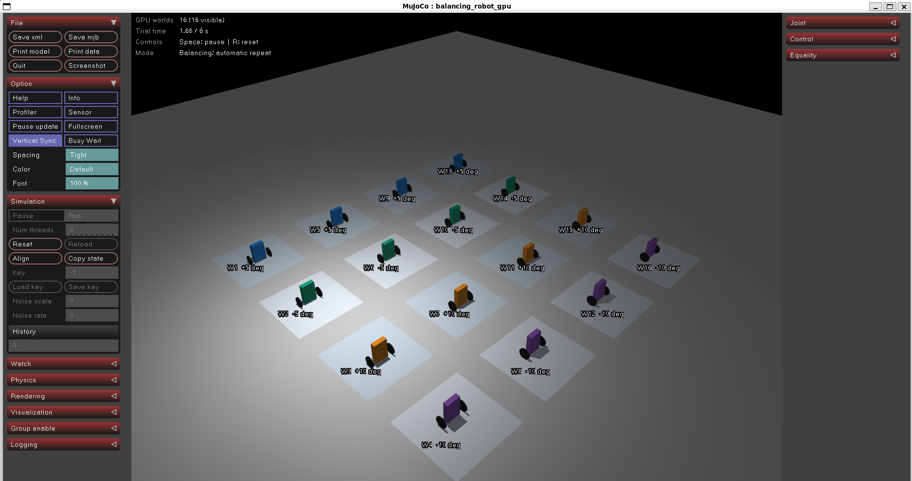

# Two-Wheel Self-Balancing Robot

A robotics portfolio project connecting physical hardware measurements, a portable
C++ controller, ROS 2 / Gazebo, GPU simulation and reproducible controller tuning.
The robot has **two-wire TT motors with no encoders**: the active controller uses
only accelerometer and gyroscope readings.


## Current result

A 512-candidate Bayesian search tuned the three pitch PID gains. The selected
controller passed eight MuJoCo training conditions, six additional starting
conditions, and **12/12 Gazebo recovery checks**: three independent launches at
each of +5, -5, +10 and -10 degrees, with 12 simulated seconds per run.
Its fixed MuJoCo training objective decreased by **25.99%** relative to the previous
gains. This is the best feasible candidate in this search, not a global optimum.

| Active setting | Value |
| --- | --- |
| Kp | 1.019130405542319 N m/rad |
| Kd | 0.020 N m s/rad |
| Ki | 1.978432718999299 N m/(rad s) |
| Combined torque request cap | 0.040 N m |
| Control period | 5 ms / 200 Hz |
| Wheel feedback | Disabled; both wheel gains are zero |

The robot can remain upright **while drifting**. These tests do not establish
wheel speed control, position hold, measured-distance travel or physical hardware
stability. Motor characteristics, sensor bias/noise, battery sag and friction
still need measurements. The Nano firmware compiles with outputs unconfigured.

[Validation report, trials and selected time series](experiments/imu-only-optimization-20261022/validation.json)
| [Method, startup fix and limitations](docs/optimization-results.md)
| [Hardware facts and assumptions](docs/hardware.md)

## Run it

Use Ubuntu 24.04, including a VS Code terminal connected to WSL 2. The Gazebo
adapter was tested with ROS 2 Jazzy and Gazebo Harmonic. Install those using the
[ROS installation instructions](https://docs.ros.org/en/jazzy/Installation/Ubuntu-Install-Debs.html)
and [Gazebo / ROS integration instructions](https://gazebosim.org/docs/harmonic/ros_installation/).
The build also requires CMake, a C++ compiler and colcon.

```bash
# In the repository root, in Ubuntu / WSL:
bash run_menu.sh
```

| Menu | Simulation |
| --- | --- |
| 1 | Gazebo with ROS 2 and the shared C++ controller |
| 2 | CPU MuJoCo with the same controller |
| 3 | GPU MuJoCo view: 16 robots using the active gains |
| 4 | Advanced tools: tuning, diagnostics, tests and Nano compilation |

For MuJoCo and GPU tools, install the separate Python environment once:

```bash
bash setup_gpu.sh
```

GPU physics requires a supported NVIDIA CUDA device. The Gaussian process and
shared C++ controller execute on CPU; MuJoCo Warp advances many physics worlds
on the GPU. Gazebo uses CPU physics and GPU graphics.

## Tune and validate

```bash
bash optimize.sh --trials 512 --seed 20261022
```

The search varies Kp, Kd and Ki, preserving geometry, motor assumptions, the
0.040 N m request cap and zero wheel gains. Each candidate runs eight different
initial states for eight seconds: +/-5 and +/-10 degree leans, +/-0.08 m/s initial
motion, and +/-10 degree/s initial pitch rate. The selected candidate receives six
additional 12-second tests at +/-7 degrees, +/-0.12 m/s and +/-15 degree/s.
These are deterministic starting-state cases, not random repetitions of hardware
uncertainty. The extra states have been used in earlier design iterations.

The objective combines pitch error, tipping rate and predicted motor current,
with a worst-case term and failed-test penalties. True simulator state is used
for evaluation, and never fed back to the controller. Drift is recorded without
requiring feedback absent from the real robot.

A winner must pass independent Gazebo checks before the script automatically
updates the active gains. Failed checks keep the previous profile. The next
normal menu run uses the updated values. Full recordings and source snapshots
stay in ignored `outputs/` folders; selected results are published in `experiments/`.
The published profile additionally passed two repeated Gazebo suites.

```bash
bash compare_optimizers.sh --trials 256   # Matched Bayesian / differential evolution experiment
```

Earlier four-gain optimizer comparisons are marked historical: they assumed
wheel feedback and do not validate this encoder-free robot.

## One controller, several adapters



The virtual IMU sits 6 cm above the wheel axle and includes motion at that site.
Simulation quantizes measurements to MPU-6050 scales and adds a 5 ms approximation
of the configured sensor filter delay. The estimator, PID, anti-windup, output
allocation and PWM conversion are shared C++. ROS carries sensor messages,
commands, evaluation telemetry and transforms.

| Folder | Purpose |
| --- | --- |
| `cpp/src/` | Portable estimator, controller, safety and behavior reference code |
| `cpp/targets/` | Host, MuJoCo and Arduino Nano adapters |
| `ros2_ws/src/balancing_robot_sim/` | ROS nodes, launch files, URDF, world and active configuration |
| `gpu/` | MuJoCo model, CUDA batches, live viewer and Bayesian / DE search |
| `analysis/` | Independent Gazebo checks, guarded profile promotion and result export |
| `experiments/` | Selected evidence and historical profiles |
| `docs/` | Hardware sources, design notes and learning guides |
| `tests/` | Regression checks; portable C++ tests live in `cpp/tests/` |

The single active profile is
[`balance.yaml`](ros2_ws/src/balancing_robot_sim/config/balance.yaml).
The old distance-based `my_routine.cpp` is retained as a reference and is disabled
in the normal simulation. A future motion routine must use available sensor inputs
and describe distance and heading uncertainty honestly.

## Physical robot and firmware

Body: 420 g, 15 x 10 x 3.5 cm. Wheels: 8 cm diameter, 0.8 cm thick,
16.8 cm center-to-center spacing. Assuming uniform body mass, its center of mass
is 4.8 cm above the axle. Electronics: classic Arduino Nano, provisionally an
MPU-6050 / GY-521 and L293D, 6 V TT motors and an internal battery. Chip markings,
wiring, motor directions and IMU axes still need verification.

```bash
bash build_cpp.sh nano        # Generates the active gains and compiles; no upload
bash build_cpp.sh components  # Six individual component sketches
```

Follow the [complete firmware walkthrough](cpp/targets/nano/sketch-walkthrough.md),
[component sketches](cpp/targets/nano/components/README.md) and
[wiring reference](cpp/targets/nano/wiring-reference.md).
Motor output pins remain unconfigured until the wiring and directions are verified.

## Checks and development history

```bash
bash build_cpp.sh test
python3 -m unittest discover -s tests -v
```

Python checks require `requirements.txt`; the shared C++ library must be built
first. GitHub Actions builds the C++ core and runs the CPU regression suite.
The initial [Python PD experiment](docs/first-experiment.md) and its
[post-processing guide](docs/postprocessing.md) remain as learning material.




No open-source license has been selected yet. Third-party software is installed
as a dependency and retains its own licensing terms.
