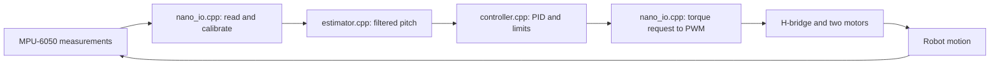

# Understand and write the balancing sketch

Read this with [RobotFirmware.ino](RobotFirmware/RobotFirmware.ino) open beside
it. A sketch is an Arduino program. In this project, the `.ino` file decides
**when** to read and control, the Nano adapter talks to the electronics, and the
shared C++ library calculates the response. Your first goal is to explain each
stage and predict what changes when you edit it.

The physical firmware currently requests **upright balance only**. It cannot
measure wheel position or speed because your motors have no encoders. It may
balance while rolling away. Holding an angle and holding a place are different
goals.

## 1. Follow the signal through the files



`RobotFirmware.ino` runs this chain repeatedly. These are the relevant files:

| File | Responsibility | What you would edit |
| --- | --- | --- |
| [RobotFirmware.ino](RobotFirmware/RobotFirmware.ino) | Startup, timing, commands, enable/disable decisions | Main program flow |
| [BoardConfig.h](RobotFirmware/BoardConfig.h) | Actual Arduino pins, motor signs, IMU address | Your verified wiring |
| [nano_io.h](RobotFirmware/nano_io.h) | Function declarations between sketch and adapter | Adapter interface |
| [nano_io.cpp](RobotFirmware/nano_io.cpp) | Calibration, axis mapping, state construction, motor commands | Hardware interpretation |
| [Mpu6050Device.h](common/Mpu6050Device.h) | I2C register reads/writes and unit conversion | Sensor-specific communication |
| [NanoMotorDevice.h](common/NanoMotorDevice.h) | Pin validation, direction pins and enable PWM | Driver-specific communication |
| [RobotCore.h](../../src/RobotCore.h) | Shared types and class declarations | Portable API |
| [estimator.cpp](../../src/estimator.cpp) | Complementary angle filter and estimation helpers | Shared estimation math |
| [controller.cpp](../../src/controller.cpp) | Pitch PID, integral limiting, torque allocation and fault checks | Shared control math |
| [motor_command.cpp](../../src/motor_command.cpp) | Torque-request-to-duty mapping | Shared actuator command mapping |
| [generate_config.py](generate_config.py) | Produce `GeneratedConfig.h` | Configuration conversion |

The Nano helper headers use Arduino/Wire. Files in `cpp/src/` do not: the same
controller can therefore be compiled for the Nano and desktop simulators.
The component sketches reuse these helpers instead of maintaining separate
versions of the balancing equations.

## 2. Includes and persistent objects

```cpp
#include <RobotCore.h>
#include "GeneratedConfig.h"
#include "nano_io.h"

robot::Controller controller(nanoSettings());
uint32_t previousTick = 0;
bool hardwareReady = false, armed = false, haveFreshMeasurement = false;
```

An `#include` makes declarations available to the compiler. `RobotCore.h`
defines `Controller`, `ControlState` and other project types. `nano_io.h`
declares functions whose implementations live in `nano_io.cpp`.

`robot::` is a namespace: it says which group this class belongs to. The line
starting `robot::Controller` creates one controller named `controller` and gives
it the settings returned by `nanoSettings()`. It lives for the program's entire
run, preserving internal state and faults between ticks. Recreating it inside
`loop()` would discard that state repeatedly.

`previousTick` stores a timestamp. `uint32_t` means an unsigned 32-bit integer.
The three booleans answer different questions:

| Variable | Meaning |
| --- | --- |
| `hardwareReady` | Did the configured motor interface and IMU initialize? |
| `armed` | Has the user requested that motor commands may be applied? |
| `haveFreshMeasurement` | Did the latest read/calibration/filter step succeed? |

Successful initialization does not mean armed. A working IMU does not prove
that its axes, motor direction or physical controller gains are correct.

## 3. `setup()` runs once

`Serial.begin(115200)` starts serial communication. Use the same baud rate in
your serial monitor. `beginHardware()` validates the motor configuration,
initializes outputs disabled, starts I2C and checks/configures the IMU. It returns
`true` or `false`, which is saved in `hardwareReady`.

The default `hardwareConfigured=false` stops initialization before motor GPIO
is touched. The `255` pin placeholders are deliberately invalid. Enter the
actual wiring in `BoardConfig.h`; do not use the numbers on an L293D package
as though they were Arduino pin numbers.

`disableMotors()` requests disabled bridge enables. The startup text explains
the mode and serial keys. `F("text")` keeps constant text in program memory on
AVR, saving scarce RAM. Finally, `previousTick=micros()` establishes a start
time for the first control interval.

There is no automatic arming and no movement sequence in `setup()`.

## 4. `loop()` stage A: schedule a control tick

```cpp
uint32_t now = micros();
uint32_t elapsed = now - previousTick;
if (elapsed < 5000UL) return;
previousTick = now;
```

Arduino calls `loop()` repeatedly. `micros()` reports elapsed microseconds;
5,000 microseconds is 0.005 seconds, so this targets **200 control updates/s**.
The `return` exits this call to `loop()`. Arduino calls it again; the program
has not ended. This avoids a blocking `delay()`.

The subtraction uses unsigned arithmetic, which handles the clock counter
wrapping, provided we keep checking within its wrap interval. `UL` marks an
unsigned-long integer literal. `dt=elapsed*1e-6` later converts the actual
interval to seconds. We use measured time because each iteration may take a
slightly different duration.

This is a scheduling target, not a measured guarantee of 200 Hz on the real
board. Excess serial printing or slow I2C can delay a tick. The main sketch
intentionally avoids printing continuously in its control path.

## 5. Stage B: process arm/disarm commands

```cpp
if (Serial.available()) {
    char key = Serial.read();
    if (key == 'd') { armed = false; disableMotors(); }
    if (key == 'a' && hardwareReady && haveFreshMeasurement) armed = true;
}
```

`Serial.available()` asks whether a received character is waiting. `read()`
consumes one character. `==` compares; `=` assigns. Single quotes represent a
character such as `'a'`; double quotes represent text.

`d` disarms. `a` arms only after initialization and a successful previous
measurement. The current tick still checks its own sensor result before any
motor command is written. `&&` means all conditions must be true and stops
evaluating as soon as one is false.

During gyro calibration, no valid balance measurement is reported, so arming
is rejected. After a sensor/timing interruption, the sketch disarms and requires
another `a`. After a fault latched inside `Controller`, reset is required too.
The firmware does not print angle telemetry or a detailed status response yet;
use component test 04 to inspect angle measurements first.

## 6. Stage C: construct the measured state

```cpp
robot::ControlState state = {};
double dt = elapsed * 1e-6;
haveFreshMeasurement = hardwareReady && readHardware(dt, state);
```

`{}` initializes the structure's numbers to zero and booleans to false.
`readHardware` fills it. The `&` in its declaration,
`ControlState& state`, means a **reference** to the caller's structure, so the
function modifies this same object rather than a private copy.

Inside `readHardware()`:

1. The device helper reads acceleration and gyro data over I2C. Failed
   communication returns `false`.
2. Sensor axes must be mapped to robot x forward, y left and z up. The current
   mapping assumes the board is already aligned; it does not detect mounting.
3. Gyro readings are converted from degrees/s to radians/s using `pi/180`.
4. The first **500 successful samples** average x/y gyro bias while stationary.
   At the intended rate this takes about **2.5 s**. Each calibration call returns
   `false`, keeping control disabled. The board must stay still throughout.
5. Subsequent readings subtract the bias and update pitch and roll estimators.
6. The adapter fills `pitch`, `pitch_rate` and an overall tilt estimate.

Calibration removes a stationary gyro offset. It does not calibrate accelerometer
scale, establish wheel direction, or redefine a tilted body as upright.

`position`, `velocity` and `yaw_rate` are currently zero placeholders, with
`wheel_feedback=false`. These zeros do **not** mean the physical robot is
stationary. The generated position/speed gains are zero so the controller does
not use those unavailable measurements. Sensor ages are set to zero after a
successful synchronous read; this adapter does not inspect a hardware timestamp
or a data-ready interrupt to prove that a register sample is new.

The MPU helper configures ranges and reads 14 bytes starting at register `0x3b`.
It skips the temperature word when extracting gyro axes. A high/low byte pair
is reconstructed as a signed 16-bit measurement. The I2C helper uses a timeout
and disables the classic Nano's internal 5 V pull-ups; verified external/module
pull-ups or appropriate level shifting are required. Register details are in
the [TDK register map](https://invensense.tdk.com/wp-content/uploads/2015/02/MPU-6000-Register-Map.pdf).

## 7. What the complementary filter does

The shared `PitchEstimator` combines two imperfect angle sources:

```text
acceleration angle = atan2(-ax, az)
predicted angle    = previous angle + gyro_y * dt
alpha              = tau / (tau + dt)
filtered angle     = alpha * predicted angle + (1 - alpha) * acceleration angle
```

The gyro follows quick rotation but accumulates bias error when integrated.
The accelerometer supplies a gravity reference while also responding to motion.
The filter uses gyro integration for the quick response and gradually corrects
it towards the acceleration angle. At startup it initializes from acceleration.

The default time constant `tau` is 0.25 s. At `dt=0.005`, `alpha` is about 0.9804.
These weights are applied repeatedly; they are not a permanent statement that
one sensor contributes 98% of the final angle under every condition. This is a
complementary filter, not a Kalman filter.

Internal angle units are **radians**. A 5-degree tilt is about 0.0873 rad.
The estimator rejects non-finite data and invalid intervals. After initialization,
near-free-fall or impact acceleration makes it propagate the gyro without a
gravity correction. Translational acceleration, vibration and the IMU's
6 cm axle offset can still affect the estimate; this is not a full inertial
navigation model.

## 8. Stage D: reject a bad tick or stay disarmed

```cpp
if (!haveFreshMeasurement || elapsed > 50000UL) {
    armed = false;
    disableMotors();
    return;
}
if (!armed) { disableMotors(); return; }
```

`!` means logical NOT; `||` means either condition. A failed read, calibration
in progress, filter rejection or a tick longer than 50 ms prevents control.
A valid reading while disarmed still updates the estimator but leaves the
motors disabled.

This is a software check when the loop gets CPU time. It is not a separate
watchdog that removes power during a frozen processor. Motor enables also need
a defined disabled state during reset/power-up; see the wiring reference.

## 9. Stage E: calculate the balance command

```cpp
robot::MotionTarget hold = {0, 0};
robot::MotorCommand command = controller.update(state, hold, dt, false);
```

`hold` contains requested forward velocity and yaw rate. The final `false`
disables the motion mode. With Nano position and velocity gains set to zero,
the target pitch is zero: upright.

For this mode, the shared calculation reduces to:

```text
limited integral          += Ki * pitch * dt
requested combined torque = Kp * pitch + Kd * pitch_rate + limited integral
bounded combined torque   = clamp(requested, -torque_limit, +torque_limit)
left torque request       = bounded / 2
right torque request      = bounded / 2
```

The integral is limited to half the torque-request cap and stops accumulating
further into saturation (anti-windup). Ki=0 gives the earlier PD controller.
The sign convention expects a forward lean to command the wheels forward under
the body. Positive gains alone cannot make a robot recover if an axis or
motor sign is reversed.

For a numerical example, take `Kp=1.0 N m/rad`,
`Kd=0.10 N m s/rad` and a combined request cap of `0.040 N m`. For a stationary
5-degree lean, P alone requests about `0.0873 N m`, so it saturates to `0.040`:
`0.020 N m` per wheel. This example shows why limits matter even at small angles.
The actual gains come from `balance.yaml` and can change after optimization;
the Nano build generates its constants from that file.

Before returning an enabled command, the core checks configuration, finite
inputs, time, sensor ages, required wheel feedback and overall tilt. The current
fall threshold is 35 degrees. A detected core fault stays latched and produces
disabled commands until the program is reset. The outer `armed` flag is separate
from this fault state.

Wheel feedback and measured-distance motion are disabled in all current adapters,
matching the actual hardware. Legacy outer-loop code remains as reference.

## 10. Stage F: convert a request to electrical outputs

`writeMotors(command)` disables outputs if the command is not enabled.
Otherwise, `dutyForTorque()` divides each torque request by the configured
full-PWM torque proxy, clamps to -1…+1, quantizes and applies the configured
deadband. `nano_io.cpp` converts that signed duty to a signed 8-bit PWM number.

`NanoMotorDevice` applies each motor's polarity, disables enable PWM while
changing its two direction pins, then sets enable PWM to the absolute magnitude.
For example, `+60` means positive direction at `60/255` duty. It does not mean
60 RPM, 60% duty or 60 units of measured torque. PWM here is Arduino's ordinary
pin PWM; frequency depends on the chosen Nano pin/timer.

Your two-wire motors and driver provide no torque/current feedback to this
code. The torque-to-duty conversion is a model-based approximation. The software
torque cap does not implement electrical current regulation, battery sag or
temperature protection. The simulator's motor physics predicts some of these
effects; the firmware sends commands to the real plant instead of simulating it.

Finally, if `command.fault` is not `NO_FAULT`, the sketch clears `armed`.
The command was already disabled by the core before this check.

## 11. Where the gains and movement order live

The main settings source remains
[`config/balance.yaml`](../../../ros2_ws/src/balancing_robot_sim/config/balance.yaml).
`bash build_cpp.sh nano` runs `generate_config.py` to create
`RobotFirmware/GeneratedConfig.h`, explicitly replacing position/speed gains
with zero for the encoder-free Nano. Do not edit the generated header; a rebuild
overwrites it. Gains tested in simulation are not automatically validated on
your physical hardware.

Body mass/dimensions enter the simulation model used to study/tune the system.
The PID controller does not recalculate body dynamics from mass every tick.
Sharing C++ means sharing algorithms; each target still supplies its own clock,
measurements and actuator interface.

Your editable movement order is
[`my_routine.cpp`](../../src/my_routine.cpp). `robot.move(...)`, `stop(...)`,
`rotate(...)` and `wait(...)` append instructions once. The routine executor
advances them over subsequent ticks while balance keeps running; `wait` does
not call Arduino `delay()`. This measured-distance sequence is now disabled in
the simulators and Nano: it used feedback absent from the actual robot.
A future IMU-only routine needs timed lean commands and gyro-based turns with
appropriate drift limits, rather than perfect simulated position.

## 12. C++ syntax you will see

| Syntax | Meaning here |
| --- | --- |
| `controller.update(...)` | Call a method on an object using `.` |
| `controllerPointer->update(...)` | Call through a pointer; no pointer is needed for the global object here |
| `ControlState& state` | Reference parameter; work on the caller's structure |
| `&pitch` at a call site | Address of `pitch`, passed so the estimator can write its result |
| `Real* out`, then `*out = angle` | Pointer parameter and writing to the value it points to |
| `const` | A value/interface that cannot be modified through that declaration |
| `static` on adapter globals | Persistent objects visible only within that `.cpp` file |
| `condition ? a : b` | Choose `a` when true, otherwise `b` |
| `static_cast<int>(value)` | Explicit type conversion |
| `void` | A function with no returned value |
| `bool` | A `true`/`false` value |

Both object methods and pointer methods are normal C++. Using `->` would not
make the controller faster, more reusable or more suitable for Arduino.

## 13. How to make this your own work

Work through the [component sketches](components/README.md), making predictions
before running each one. Then try these small tasks:

1. Explain why a stationary tilted IMU has nonzero angle but near-zero gyro rate.
2. Calculate P, D and the capped torque for a chosen angle/rate on paper; compare
   with `controller.cpp`. Keep degrees and radians separate.
3. Describe exactly what happens from receiving `a` to writing PWM, including a
   failed-read case. Explain why the robot can still drift with `hold={0,0}`.
4. Compare Ki=0 with a small integral gain in simulation, using a separate
   parameter profile. Explain pitch recovery and drift separately.
5. Keep a short experiment log: prediction, edit, observed result and explanation.

You do not need to rewrite every driver to understand the project. Being able
to trace a signal, identify a wrong assumption, make a deliberate change and
explain the measured result is the useful engineering skill.
