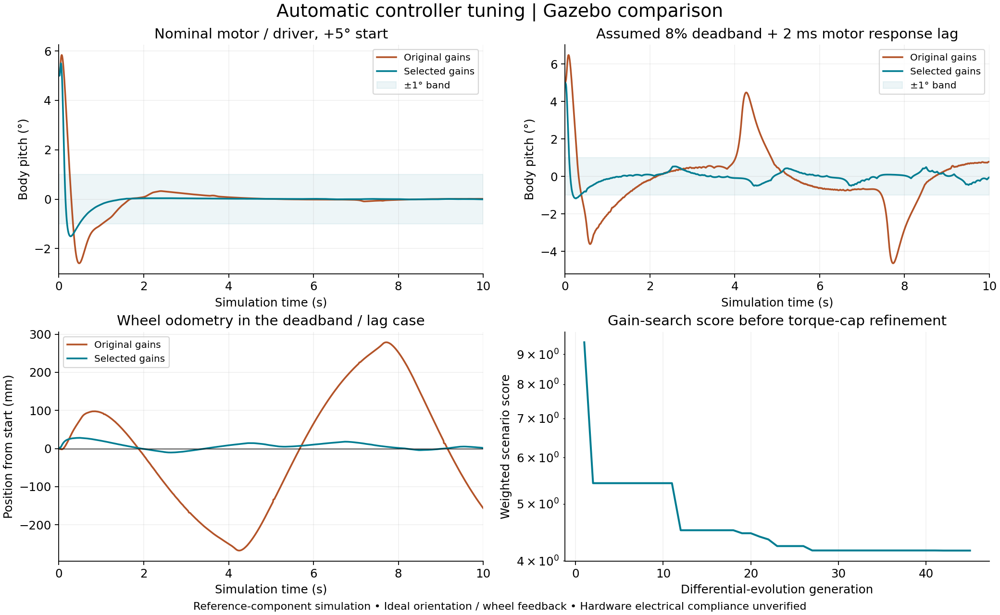

# Automated controller tuning

This search and its plots used the original 300 g / 25 cm geometry. The current
420 g measured geometry is recorded in [hardware.md](hardware.md). Existing
gains were retained and passed new nominal balance/shuttle checks, but this
search has not been repeated for the new geometry. Its old rankings and
robustness counts should not be read as a new optimization result.

The search tunes the existing position-holding balance controller. It is an
offline simulation experiment, not an adaptive or AI controller running on the
robot. A bounded search over finite cases does not establish a global optimum.

## What is tuned

The first stage changes four gains. Geometry, motor calibration, PWM mode and
the +/-5 degree desired-lean cap remain fixed. A second stage also searches the
total torque request cap, without exceeding the original +/-0.060 N m bound:

```text
desired_pitch = clip(-position_gain * x - velocity_gain * v, +/-5 degrees)
requested_total_torque = clip(kp * (pitch - desired_pitch) + kd * pitch_rate,
                              +/-total_torque_limit_nm)
```

The selected simulation default is **Kp = 1.0, Kd = 0.1, position gain = 0.15,
velocity gain = 0.35, and total request cap = 0.040 N m**. These are the best
validated compromise found in this experiment, not a proof of optimality.

Angles in the calculations are radians. Wheel odometry is relative to the
starting point. The [baseline profile](../ros2_ws/src/balancing_robot_sim/config/balance-baseline.yaml)
preserves the previous model-informed gains. The optional student exercise and
the first Python pitch-only demo retain their original reference gains.

## Search and validation

`analysis/tune_controller.py` uses SciPy differential evolution with a recorded
random seed. Each candidate is evaluated in a batched nonlinear rolling model
with the existing TT/L293D averaged coast-PWM equations, 8-bit quantization,
source sag and optional mean-current response lag. Control updates every 5 ms;
RK4 integrates the mechanics. Automated independent checks compare its motor
calculations with the original motor module and its accelerations with the
existing mass-matrix dynamics. Finalists are also integrated with 1 ms RK4 steps
while keeping the same 5 ms control period.

The first wide search favored aggressive gains that failed actual Gazebo
validation. Its two recordings remain in `outputs/controller-preliminary-gazebo`.
The nominal case fell; the deadband/lag case failed the angular-rate criterion.
A short-window timing search improved nominal recovery but still oscillated
under deadband; finer integration and longer runs exposed failures hidden by
the final-second score. These rejected results are retained, not promoted.

The final differential-evolution pass used Kp 0.18–0.65, Kd 0.010–0.080,
position gain 0.04–0.60 and velocity gain 0.10–0.60. It evaluated 15-second
runs with 2.5 ms mechanical integration and scored the final five seconds.
The final population was then ranked over 20 seconds with 1 ms integration,
scoring seconds 10–20. Current/thermal prediction failures in actual Gazebo
motivated a lower request-cap sweep. A local grid also explored Kp up to 1.0
and Kd up to 0.12 under reduced caps, followed by the same 20-second refinement.
An intermediate cap was checked in Gazebo to assess the recovery/current tradeoff.

The expanded design set has 21 cases, including 5/10 degree starts, assumed
8% deadband and 2 ms mean-current lag, a 5.5 V source with 0.5 ohm internal
resistance, a higher driver-drop curve, combined actuator uncertainty, body mass
of 0.24/0.36 kg, a slower/weaker motor, a moving start, and feedback delays of
5–15 ms. These variations are deliberate design assumptions, not measurements
of the owner's components. Nine additional scenarios cover negative/intermediate
starts, combinations, later velocity impulses, and a 20 ms delay, over 20 s.
They are excluded from the numerical objective but were inspected during design
iterations; they are not a sealed, blind benchmark. The earlier 10 ms delay
test informed the expanded design and is included in the design set.

Each design case has a dimensionless score. It combines time-averaged squared
pitch, position, speed, pitch rate and average motor current; a late-window
error term; and settling time. A scenario's motor-current-squared term is an
effort proxy, not energy. The total objective is:

```text
mean(case_costs) + 0.75 * max(case_costs)
```

The exact normalizations and weights live in `score_metrics()` in
`analysis/tuning_model.py`. Response penalties cover tilt above 20 degrees,
late-window pitch above 1 degree or pitch rate above 5 deg/s, final position
outside 0.1 m, and final speed above 0.05 m/s. Falls receive a large penalty.
Prediction penalties cover mean motor current above 0.6 A, estimated ON current
above 1.2 A, bus voltage below 5 V, and the steady-state junction proxy above
150 C. The RMS-current and pulse-current uncertainties are retained separately.
Passing these prediction checks does **not** establish electrical compliance;
the L293D peak rating is not permission for repetitive 1.2 A PWM pulses.

Settling uses |pitch| <=1 degree, |pitch rate| <=5 deg/s, |position| <=20 mm,
and |speed| <=20 mm/s through the remaining observation window for at least
0.5 s. Residual deadband oscillation can remain within those bands. A later
disturbance resets the measured settling time; it is measured from simulation
start, not from the impulse.

`analysis/validate_tuning.py` then runs the actual ROS/Gazebo pipeline with the
baseline and candidate profiles under matching initial conditions and motor
settings. Every recording includes the effective YAML, source hashes, model and
world snapshots, controller/motor telemetry, independent response checks, and
the launch log. Transport timing and three-dimensional contact make these
responses vary between runs; rejected and failed trials are preserved too.

## Recorded results

Recorded 2026-10-21 with ROS 2 Jazzy / Gazebo Harmonic 8.15.0 under WSL2.
The final evolutionary pass used seed 20261023, population 40 and 45 generations
(1,840 population evaluations). A local sweep screened 180 gain/cap combinations
and refined 24 finalists. Earlier rejected searches and recordings are retained.



The default now passes **7 of 9** matched ten-second Gazebo response checks;
the original preset passes **4 of 9**. The plot's search curve is the gain-only
stage before torque-cap refinement; its score is not directly the final
profile's multi-stage score. Read the [selected machine-readable evidence](images/controller-tuning.json)
for parameters, metric definitions, source hashes and actuator diagnostics.

| Case | Original response | Selected response | Selected final-second pitch | Selected final position | Peak average current per motor |
| --- | --- | --- | --- | --- | --- |
| Nominal +5 degrees | Pass | Pass | 0.011 deg | +0.25 mm | 0.413 A |
| Nominal -5 degrees | Pass | Pass | 0.010 deg | -0.25 mm | 0.383 A |
| Nominal +10 degrees | Pass | Pass | 0.012 deg | +0.55 mm | 0.410 A |
| Deadband/lag +5 degrees | Fail | Pass | 0.460 deg | +1.50 mm | 0.362 A |
| Deadband/lag -5 degrees | Fail | Pass | 0.511 deg | -16.26 mm | 0.360 A |
| Deadband/lag +10 degrees | Fail | **Fail** | 0.571 deg | +2.10 mm | 0.376 A |
| Lower battery +10 degrees | Fail | **Fell** | — | — | 0.385 A before cutoff |
| Higher driver drop +5 degrees | Pass | Pass | 0.011 deg | +0.07 mm | 0.305 A |
| Combined actuator variations +5 degrees | Fail | Pass | 0.533 deg | -4.26 mm | 0.224 A |

The 10-degree deadband case remains upright but misses the rate threshold:
5.029 deg/s in its final second, against a 5 deg/s limit. In a separate
20-second +5-degree deadband run, pitch stays bounded at 0.514 degrees in the
final second and position ends at -9.93 mm, but rate reaches 5.236 deg/s and
the settling check fails. Thus the ten-second pass does not establish complete
settling or robustness. The matching long nominal run passes, ending at
-0.106 mm with a final-second pitch maximum of 0.0098 degrees.

The selected profile also fails the fast model's combined-uncertainty
10-degree recovery case and its additional 20 ms feedback-delay test. An
intermediate 0.050 N m cap passed nominal +5 but failed the tested deadband
and reduced-battery +10 cases in Gazebo; it was not selected. No tested
setting passed every extended response check. The additional scenarios were
used to expose these limits rather than remove failed results.

All nine selected-profile recordings stay below the screened average-current,
RMS proxy, 1.2 A ON-current estimate, supply and thermal-proxy thresholds before
any fall cutoff. **All still flag uncertain PWM pulse compliance**, because
their estimated ON current exceeds 0.6 A and repetitive capability is not
established. Neither those estimates nor the selected torque cap establish
hardware electrical safety or current regulation.

The installed default was rebuilt and independently checked once more at
+5 degrees: response checks pass, final-second pitch 0.0096 degrees, final
position +0.141 mm, and peak estimated mean current 0.397 A. All **43 unit
checks** pass. The original gains remain in `balance-baseline.yaml`; motor
calibration, robot geometry, and physical component assumptions were unchanged.

## Reproduction

Run from the repository root. The search needs the existing NumPy/SciPy Python
environment and no ROS:

```bash
python analysis/tune_controller.py --timing-stress --robust-window --kd-max 0.08 --seed 20261023 --generations 45 --population 40 --output outputs/my-controller-search
python analysis/select_tuning_cap.py outputs/my-controller-search --max-cap 0.045 --refine-neighborhood --output outputs/my-cap-search
```

Then, from the configured Ubuntu/WSL terminal:

```bash
source /opt/ros/jazzy/setup.bash
cd ros2_ws
colcon build --symlink-install --packages-select balancing_robot_sim
source install/setup.bash
cd ..
python3 analysis/validate_tuning.py --candidate outputs/my-cap-search/candidate.yaml --output outputs/my-controller-validation
python3 analysis/plot_tuning.py outputs/my-controller-search outputs/my-controller-validation --selection outputs/my-cap-search --output docs/images/my-controller-tuning.png
```

The exact selected comparison uses these preserved local recording directories:

```bash
python analysis/plot_tuning.py outputs/controller-search-robust-final outputs/controller-selected-gazebo-v2 --selection outputs/controller-cap-refined --long-validation outputs/controller-selected-long-check --output docs/images/controller-tuning.png
```

Run the selected default with `bash run_gazebo.sh`. To compare the original
full preset, from the repository root use:

```bash
bash run_gazebo.sh params_file:="$(pwd)/ros2_ws/src/balancing_robot_sim/config/balance-baseline.yaml"
```

Use fresh output paths to preserve experiments. The validator resumes existing
case folders without replacing their recordings. Do not reuse a validation
directory with different candidate gains. Run validators sequentially because
they use the same isolated ROS domain. Each Gazebo process has its own transport
partition; normal user simulations use the default ROS domain.

## Limits

The fast model assumes identical wheels, no slip, ideal orientation and wheel
feedback. Delay cases are simplified fixed delays, not a measured ROS scheduler
or physical IMU filter. The impulse cases change planar velocity instantaneously;
they are not an identified physical push. Independent Gazebo tests cover its
actual contacts and ROS scheduling, but physical encoders, IMU estimation,
backlash, winding/switching behavior, and real component identification remain
future work. See [actuator assumptions](motor-driver-model.md).
