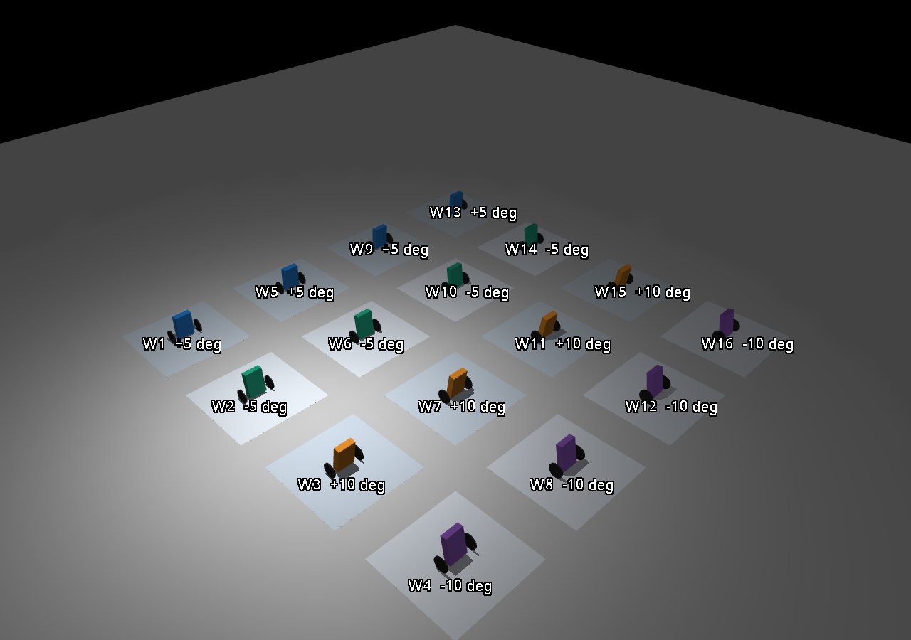
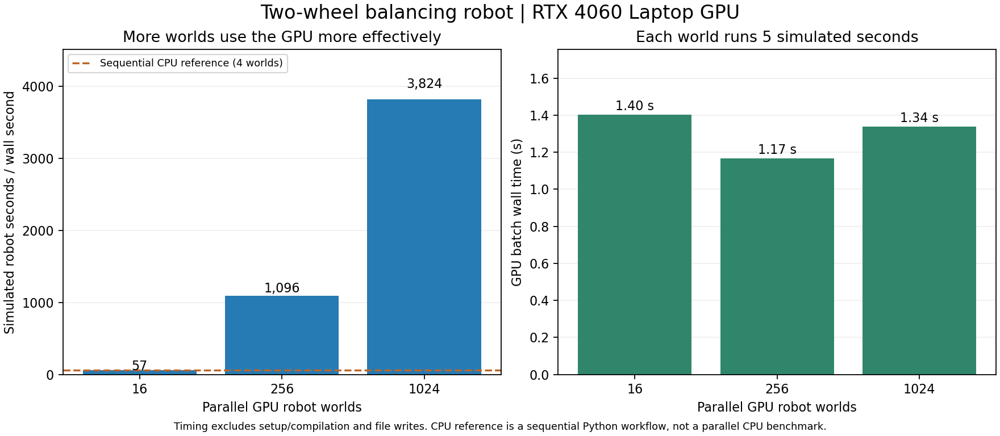

# GPU parallel balancing experiment

The [current hardware guide](imu-only-control.md) supersedes the controller
descriptions below. All normal adapters now use accelerometer/gyro readings,
the shared Nano estimator and pitch PID. Wheel feedback and the historical
`--legacy-controller` option are disabled. Benchmarks below are historical.

MuJoCo Warp runs independent copies of the two-wheel robot on an NVIDIA GPU.
Physics integration and contact solving run on the GPU. As of the shared-C++
refactor, balance control and nominal TT/L293D calculations run in C++ on the
CPU, with state/command transfers at 200 Hz. The viewer, batch and optimizer
use the same portable controller as Gazebo and Nano. Transfers are timed.
`--legacy-controller` on the headless batch reproduces the historical separate
Warp control kernel. Benchmark timings below describe that earlier implementation;
they must not be presented as measurements of the new shared-C++ path.

## Run

Use the configured Ubuntu/WSL terminal, from the repository root:

```bash
bash setup_gpu.sh
bash run_gpu.sh --worlds 256 --seconds 5
```

Choose **4 → 2** (Advanced → GPU balance batch) in the menu to run the default 256-world batch. It is a headless experiment:
there is no Gazebo or MuJoCo window. It prints the GPU name, checks and timing,
then saves `summary.json`, `candidates.csv`, `inputs.npz`, `run.json` and source
snapshots in a fresh folder under `outputs/`. The first run compiles kernels;
subsequent runs reuse the Linux kernel cache. Ctrl+C interrupts the experiment.

Dependencies are pinned in `gpu/requirements.txt` and isolated under
`${XDG_CACHE_HOME:-$HOME/.cache}/self-balancing-robot/gpu-venv`. The setup helper
requires Ubuntu's `python3-venv` package. It keeps package files on Linux storage
because installing thousands of Python files on the Windows-mounted project
drive is slow. `ROBOT_GPU_PYTHON` can select an existing compatible interpreter.
CUDA must be available; the runner rejects a silent CPU fallback.

## Live multi-robot window

Choose **4 → 1** (Advanced → GPU live view), or run:

```bash
bash run_gpu.sh --view --worlds 16
bash run_gpu.sh --view --worlds 64
```

The native MuJoCo window displays the independent GPU worlds in a grid spaced
0.75 m apart. These offsets affect the display only: each robot has its own
physics world and cannot hit another robot. Labels identify world number and
starting tilt; colors distinguish the +5, -5, +10 and -10 degree groups.
The first two robots use the existing gains; later robots use the same seeded
gain perturbations as the batch experiment. These are balancing trials, not
the Gazebo shuttle routine.

- Space pauses/resumes; R restarts all trials.
- Use the mouse to orbit/zoom; close the window or press Ctrl+C to exit.
- Trials repeat every six simulated seconds so recovery remains visible.
- `--show 16` draws at most 16 robots while any additional GPU worlds still run.
  The default visible limit is 64; the supported maximum is 256.
- `--spacing 1.0` increases display spacing; `--period 10` repeats less often.

The loop targets real time rather than benchmark speed. Copying poses back for
display and drawing the window adds overhead, so rendering many robots can slow
playback. Mouse perturbations in the native window do not feed forces back into
the independent GPU worlds; the mouse controls here are for viewing.



The grid image uses actual GPU poses at trial start. A bounded native-window
check completed 340 frames (6.78 simulated seconds), automatically reset once,
and exited with finite states and no buffer overflow. Its log is preserved in
`outputs/gpu-live-view-check.log`. Generate a fresh grid image with:

```bash
bash run_gpu.sh --view --snapshot outputs/my-gpu-grid.png
```

## Model and scope

The GPU loader applies the shared `config/robot_geometry.json` measurements to
`gpu/robot.xml`: a 420 g, 15 x 10 x 3.5 cm box, two assumed-20 g cylinders of
radius 4 cm and width 0.8 cm, and 16.8 cm wheel-center spacing. The box bottom is
2.7 cm below the axle, putting the uniform COM 4.8 cm above it. The IMU site is
6 cm above the axle. Body mass includes electronics. The robot is a free body with two driven hinge joints over a plane;
MuJoCo solves contact instead of imposing no-slip planar dynamics. Friction
0.8, masses and dimensions match the Gazebo assumptions. The engines' contact
models differ, so identical behavior across engines has not been established.

The existing position/speed feedback and pitch PD run at 200 Hz. Contact physics
runs at 1 kHz, with each motor torque held across five integration steps. The
controller uses ideal quaternion/body-rate feedback and wheel-based odometry,
the same fixed torque-to-duty calibration and 8-bit coast PWM equations as the
original motor model. Each wheel's relative shaft speed enters back EMF and drag.
The 35-degree pitch cutoff latches zero requests; motor drag still applies.

Only the nominal fixed-voltage, quasi-static coast-PWM actuator is supported.
The runner rejects battery resistance, current lag or braking-mode settings it
cannot reproduce. ROS transport/delays, noisy sensors, turning/shuttle motion,
battery chemistry, backlash and detailed switching/thermal behavior are absent.
The current outputs diagnose average and estimated ON current; they do not
establish hardware rating compliance.

## What the batch does

The first two worlds use the existing balance preset at +5 and -5 degrees.
Further worlds perturb the four gains by +/-25% using a recorded seed and cycle
through +5, -5, +10 and -10 degree starts. Torque caps remain at the configured
0.040 N m. Each candidate is tested in only one start condition. A low score
therefore identifies a world to investigate, not a robust controller to install.
The runner never replaces the Gazebo controller configuration.

Response checks require finite state, no fall cutoff, peak pitch below 20
degrees, final-second pitch below 1 degree and pitch rate below 5 degrees/s,
and final displacement/speed below 0.10 m / 0.05 m/s. A dimensionless score sums
normalized time-average squared pitch, wheel distance and speed; failed
responses receive a 1000-point penalty. These score weights are provisional.
There is no Bayesian optimization, reinforcement learning or proof of optimality
in this batch.

Before interpreting a run, the runner checks the GPU control/motor calculation
against the independent existing Python `MotorDriverModel` at varied wheel
speeds/errors. It also compares 0.1 seconds of CPU MuJoCo and GPU MuJoCo Warp
physics for up to four identical inputs, and reports the final longer-run
differences. Contact systems and PWM quantization can amplify floating-point
differences. GPU buffer overflow is checked and treated as a failure.

## Recorded check, 2026-10-21

The benchmark table below and its plot use the original geometry. The measured
420 g geometry has its own passing 256-world record in
`outputs/gpu-measured-geometry-check`: all 256 response cases passed, as did
CPU/GPU motor and short-physics checks. The live-grid image uses the updated
model; the earlier timing comparison remains a historical benchmark.

Environment: Ubuntu 24.04 under WSL2, RTX 4060 Laptop GPU (8 GiB), MuJoCo and
MuJoCo Warp 3.16.0, Warp 1.18.0, NumPy 2.5.4. Preserved runs:
`outputs/gpu-first-check` (16 worlds), `outputs/gpu-256-check` (256 worlds),
and `outputs/gpu-1024-check` (1024 worlds).

| Measurement | 16 worlds | 256 worlds | 1024 worlds |
| --- | ---: | ---: | ---: |
| Simulated seconds per world | 5 | 5 | 5 |
| GPU batch wall time, after warm-up | 1.40 s | 1.17 s | 1.34 s |
| Aggregate simulated seconds per wall second | 57 | 1096 | 3824 |
| Four-world sequential CPU reference wall time | 0.350 s | 0.361 s | 0.354 s |
| Ratio of GPU/CPU aggregate throughput | 1.00 | 19.8 | 67.8 |
| Worlds passing response checks | 16 / 16 | 255 / 256 | 1023 / 1024 |



Both existing-preset +/-5-degree cases passed. The 256-world run's maximum
motor/controller torque difference was 5.82e-9 N m. The short physics comparison
differed by at most 8.79e-8 in qpos and 1.62e-6 in qvel. The five-second comparison
reported maximum differences of 2.20e-4 and 7.39e-4 respectively. Both runs had
finite states and no GPU buffer overflow; the 1024-world run also passed these
checks. Existing 50 project unit checks pass. Selected summaries and their source
hashes are preserved in [gpu-simulation.json](images/gpu-simulation.json).

Timing includes GPU control, metrics and physics, with synchronization around
the timed loop. It excludes setup/graph capture, compilation and output writes.
The CPU reference uses one Python process, the existing Python controller/motor
calculation and CPU MuJoCo, on four worlds for the same five seconds. It is not
a multithreaded CPU benchmark, a Gazebo speed comparison, or a pure-physics
kernel comparison. The first uncached compilation took about 52 seconds; the
256-world cached setup took about one second. Laptop power/thermal state and
other apps affect these single-run timings.

## Bayesian optimization

`bash optimize.sh` uses this backend for a Gaussian-process Bayesian search
with expected improvement. Each candidate is evaluated across eight initial
states; the winner is checked on six held-out states. This adds an aggregate
objective and feasibility gates, while keeping the nominal actuator and geometry
fixed. It does not yet randomize hardware uncertainty. The original batch
command remains a screening/benchmark tool. See the
[optimization guide](gpu-optimization.md) for commands, scoring and limitations.
Shortlisted gains need independent Gazebo response and shuttle checks before
any default changes.

Primary references: [MuJoCo Warp overview and API](https://mujoco.readthedocs.io/en/stable/mjwarp/index.html),
[MuJoCo Warp source](https://github.com/google-deepmind/mujoco_warp),
[BoTorch overview](https://botorch.org/docs/v0.17.2/overview).
