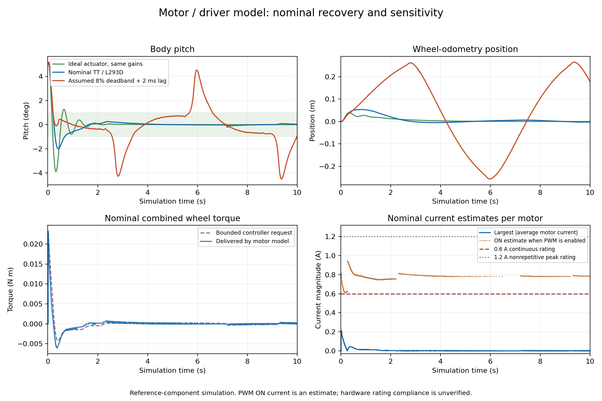

# Motor / driver simulation checks

The historical results below used the original 300 g / 25 cm body. Current
measurements and fresh nominal checks are documented in [hardware.md](hardware.md)
and [ros-balancing-demo.md](ros-balancing-demo.md). The electrical model is unchanged.

Recorded 2026-10-21 using ROS 2 Jazzy and Gazebo Harmonic 8.15.0 in Ubuntu 24.04
through WSL 2. These are reference-component simulations, not hardware measurements.

This is the **historical motor-model baseline**, before the automated gain
search. Its full settings are preserved in `config/balance-baseline.yaml`.
See [the tuning comparison](controller-tuning.md) for the current default.



## Recorded outcomes

All runs use the same geometry, 1 ms physics step, 200 Hz nominal sensor/control
rate, inner PD gains, position gain, and 0.18 outer velocity gain. The actuator
settings or initial tilt vary as labelled. ROS transport/scheduling makes the
recorded trajectories vary slightly between runs. Each scored window is ten
simulated seconds; the last-second pitch metric covers seconds 9 through 10.

| Case | Response checks | Largest absolute pitch in final second | Final odometry position | Largest average motor current | Largest estimated PWM ON current |
| --- | --- | --- | --- | --- | --- |
| Ideal actuator, +5 deg | Pass | 0.00033 deg | +0.031 mm | Not modelled | Not modelled |
| Nominal motor/driver, +5 deg | Pass | 0.089 deg | -2.45 mm | 0.218 A | 0.944 A |
| Nominal motor/driver, -5 deg | Pass | 0.085 deg | +4.10 mm | 0.222 A | 0.931 A |
| Nominal motor/driver, +10 deg | Pass | 0.084 deg | -3.93 mm | 0.427 A | 1.088 A |
| Assumed 5.5 V source + 0.5 ohm source resistance, +5 deg | Pass | 0.014 deg | +1.93 mm | 0.187 A | 0.850 A |
| Maximum-drop driver anchor, +5 deg | Pass | 0.102 deg | +1.81 mm | 0.152 A | 0.772 A |
| Assumed 8% deadband + 2 ms mean-current lag, +5 deg | **Fails settling/position/speed checks** | 4.511 deg | +177.71 mm | 0.209 A | 0.936 A |

Response checks require completion without a controller fault, the expected
initial tilt, staying within 20 degrees, final-second pitch below 1 degree and
rate below 5 deg/s, final position within 0.1 m, final speed below 0.05 m/s,
and respecting the controller's configured command cap. The stress case
remained upright but oscillated and drifted. Its deadband and lag are deliberate
unmeasured assumptions; this does not establish that the physical robot fails.

## Electrical interpretation

All motor-model cases flag uncertain PWM pulse compliance. Their average
currents remain below the 0.6 A reference continuous rating, but estimated ON
currents exceed it. The +10 degree case also exceeds 0.6 A in the RMS proxy.
The 1.2 A datasheet peak is nonrepetitive for at most 100 microseconds. These
estimates cannot establish actual pulse peaks or repetitive capability without
the winding inductance, switching behaviour, and PWM wiring.

The lower-battery run reaches about 5.313 V on the shared bus. None of these
cases establishes physical current or thermal compliance. The steady-state
temperature field is a conduction-loss/JEDEC-cooling proxy, not a measured or
transient junction temperature. See the [model assumptions](motor-driver-model.md).

The original 0.10 velocity gain produced slower position oscillations with
the motor surrogate; one recorded +5 degree run failed the 0.05 m/s final-speed
criterion. Increasing that gain to 0.18 restores the small-signal damping
reduced by shaft drag. The pitch PD gains and hardware reference parameters
were not changed to make a failed stress case pass.

## Data and reproduction

The recorded folders under the Git-ignored `outputs/` directory are:

```text
motor-driver-ideal-same-gains
motor-driver-default-final
motor-driver-final-minus5deg
motor-driver-final-10deg
motor-sensitivity-lower-battery
motor-sensitivity-driver-max-drop
motor-sensitivity-deadband-lag
```

Each contains effective parameters, source hashes, model/world snapshots,
controller and motor telemetry, IMU observations, a JSON summary, and the
launch log. The summaries distinguish response success from the unestablished
hardware rating compliance. Earlier development/failed-start recordings are
retained separately and are not substituted for these selected results.

See [the model guide](motor-driver-model.md#reproduce-checks) for run commands.
After generating the three plotted cases, recreate the selected figure from
the repository root with:

```bash
python analysis/plot_motor_runs.py outputs/motor-driver-default-final outputs/motor-sensitivity-deadband-lag --ideal outputs/motor-driver-ideal-same-gains --output docs/images/motor-model-response.png
```

The plot tool only reads saved data. It uses the existing NumPy/Matplotlib
dependencies and does not require ROS. Its current panel shows ON estimates
only when PWM is enabled; it is not a resolved 490 Hz current waveform.

All 36 unit checks pass, including motor reference endpoints, torque-speed
behaviour, PWM quantization, coasting/braking, battery coupling, response-lag
sensitivity, and rejection of an invented driver current clamp. Both the
passing nominal responses and the failing stress response are preserved.
