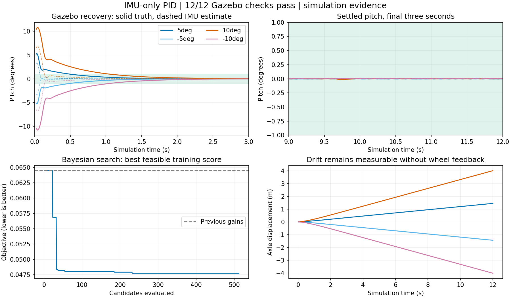

# IMU-only optimization and repeated validation

The selected profile uses **Kp=1.019130405542319, Kd=0.020,
Ki=1.978432718999299**, with the existing combined request cap of 0.040 N m.
Both wheel gains remain zero and wheel feedback remains disabled.
These are simulation-validated gains; the physical robot has not been tested.



## What changed before tuning

The earlier corrected controller recovered in MuJoCo but failed some Gazebo
10-degree tests. Inspection of saved motor traces found a startup race: physics
was deliberately paused while the ROS bridges connected, yet wall-time
watchdogs could erase the first balance command before release. In one failed
case there was approximately 50 ms of additional simulated tipping before
both motors received their command.

The Gazebo controller now refreshes its last valid motor request during paused
startup. The simulated motor driver expires plant state against advancing
simulation time, while keeping a separate wall-time command watchdog. After
startup, stale IMU data still disables torque. Latched faults still disable it
during startup too. No simulator orientation, wheel speed or position was added
to the feedback path. Nano firmware and its local watchdog are unchanged.

With this fix, the previous gains passed new +10 and -10 degree checks. The
new gains were then selected through the search below. Consequently, the
Gazebo improvement is **not a gain-only comparison** with the historical runs.

## Search protocol

| Setting | Recorded value |
| --- | --- |
| Method | Gaussian-process Bayesian optimization, Matern 5/2, analytic expected improvement |
| Seed / candidates | 20261022 / 512, including the incumbent |
| Batch size | Eight candidates, eight physics worlds per candidate |
| Search variables | Kp 0.30-4.0, Kd 0.020-0.80, Ki 0-2.0 |
| Fixed settings | Geometry, actuator model, 0.040 N m cap, zero wheel gains |
| Training cases per candidate | Eight, each eight simulated seconds |
| Additional selected-candidate checks | Six, each 12 simulated seconds |
| Execution | MuJoCo Warp physics on RTX 4060 Laptop GPU; C++ controller and GP on CPU |
| Feasible training candidates | 349 of 512 |
| Previous / selected training objective | 0.064487539 / 0.047728500 |
| Reduction in training objective | 25.99% |

The eight training conditions are +/-5 and +/-10 degree leans, +/-0.08 m/s
initial forward motion, and +/-10 degree/s initial pitch rate. Additional
conditions use +/-7 degrees, +/-0.12 m/s and +/-15 degree/s respectively.
They are different initial conditions, with one deterministic simulation per
candidate-condition pair. They have been used in earlier design iterations;
they are not a statistically untouched holdout.

The fixed objective combines integrated true pitch error, final-second pitch
and pitch-rate error, predicted average current and a worst-case term. Failed
tilt, rate, finite-state, fault or electrical-prediction checks receive penalties.
Evaluation uses ground truth to prevent an inaccurate IMU estimate from hiding
a fall. The actual controller sees only delayed, quantized accelerometer and
gyro measurements processed by the shared C++ estimator.

## Independent Gazebo validation

The candidate passed **12/12 checks**: three separately launched 12-second
runs at each of +5, -5, +10 and -10 degrees. Each run must complete, avoid a
controller fault, start at the requested tilt, stay within 20 degrees, finish
within 1 degree and 5 degrees/s, and respect the command cap. Existing
predicted electrical thresholds are also checked. The acceptance thresholds
were retained throughout the search and validation.

These repetitions exercise launch and message timing. They do not vary
unmeasured mass, friction, sensor bias/noise or battery characteristics.
The body can settle upright while the robot continues rolling. Displacement
and velocity remain evaluation diagnostics, not hidden wheel feedback or
position-hold acceptance criteria.

The passing candidate is applied through the existing source-hash and
parameter checks in `analysis/apply_optimized_gains.py`. The next normal
menu launch loads it from `config/balance.yaml`.

## Saved evidence and commands

The [published experiment](../experiments/imu-only-optimization-20261022/validation.json)
contains every repeated Gazebo summary, the search manifest, all 512 candidate
records, the pre-search profile, selected profile and first-repetition controller
CSV traces. Full motor/IMU recordings and source snapshots remain under local
`outputs/imu-robust-search-512-20261022/`, excluded from Git.

```bash
bash run_menu.sh                         # Normal simulations use the active gains
bash optimize.sh --trials 512 --seed 20261022
bash build_cpp.sh test
source /opt/ros/jazzy/setup.bash
python3 -m unittest discover -s tests -v  # Includes six pause/watchdog regressions
bash build_cpp.sh nano                   # Compile only; outputs remain unconfigured
```

A new search starts from the current profile; the stored `current.yaml`
records the incumbent used in this particular experiment. Runtime versions,
model parameters and source hashes are saved with the search. Reproducing a
new run does not imply bit-identical CUDA arithmetic or ROS message timing.

This project still needs measured motor/driver behavior, verified wiring and
sensor axes, and physical balancing trials. The model approximates MPU filter
delay rather than its complete frequency response. Passing current estimates
does not establish real L293D PWM pulse or thermal compliance. Exact position,
wheel velocity and distance-based routines are unavailable from this IMU-only
implementation. A connected, calibrated digital twin remains future work.
