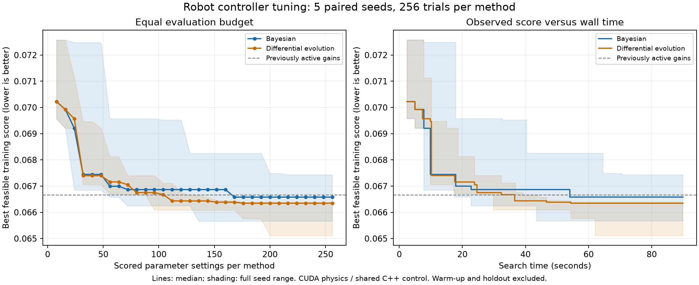

# Extended controller optimization: 256 trials per method

**Historical encoder-feedback experiment.** These gains relied on unavailable
wheel measurements and have been withdrawn from the hardware simulation. See
the [corrected IMU-only controller](imu-only-control.md). Statements about active
gains below describe the state at the time of this historical experiment.

Measured on 2026-10-22 with the RTX 4060 Laptop GPU. Both optimizers ran
**256 parameter settings across each of five paired seeds**, extending the
[earlier 64-trial comparison](optimizer-comparison.md). Differential evolution
found the lowest individual and median training scores at this larger budget.
**Both finalists passed validation, and the new DE gains are active in the
normal menu.** Its training score was 2.32% lower than the measured previously
active controller's score.



## Search results

Lower scores are better. These scores measure the fixed weighted objective,
not a percentage improvement in walking speed or real hardware performance.

| Measurement | Bayesian | Differential evolution |
| --- | ---: | ---: |
| Best training score | 0.06566247 | 0.06511130 |
| Median best training score | 0.06657889 | 0.06634783 |
| Median search time per seed | 84.87 s | 79.10 s |
| Training-feasible selected controllers | 5/5 | 5/5 |
| Selected controllers passing six extra conditions | 5/5 | 5/5 |
| Runs improving after trial 64 | 4/5 | 5/5 |

Nine of ten searches improved after trial 64; individual score reductions
ranged from zero to about 3.4%. The plot shows median performance and the full
range across seeds. Variation between starts remains larger than the small
difference between the method medians. This is a result for these implementations,
bounds, model and budget, rather than a universal ranking of optimizers.

Comparing the first 64 observations with the final 256 within these same runs:

| Median best training score | Bayesian | Differential evolution |
| --- | ---: | ---: |
| At 64 evaluations | 0.06699263 | 0.06716123 |
| At 256 evaluations | 0.06657889 | 0.06634783 |
| Reduction | 0.62% | 1.21% |

## Independent validation and active gains

| Finalist check | Bayesian | Differential evolution |
| --- | ---: | ---: |
| Gazebo recovery/position/speed cases | 4/4 pass | 4/4 pass |
| Electrical prediction cases | 4/4 pass | 4/4 pass |
| Largest predicted PWM-on current | 1.166339 A | 1.139905 A |
| Default round trip | Pass | Pass |
| Movement completion time | 34.290 s | 37.285 s |
| First leg, independent world pose | 0.495828 m | 0.497820 m |
| Second leg, independent world pose | 0.496072 m | 0.498314 m |
| Half-turn error | 0.3725 degrees | 0.3509 degrees |

The DE finalist won on the declared training objective after both passed the
acceptance gates. It did not have the quickest movement routine: the previous
active controller completed the earlier recorded round trip in 34.165 simulated
seconds. Walking time is not part of this balance-recovery objective. Electrical
values above are model predictions against the existing checks, not measured
hardware current or proof of driver pulse/thermal compliance.

The four active gains now are:

| Gain | Value |
| --- | ---: |
| Kp | 0.3626432845097475 |
| Kd | 0.020857769171907126 |
| Position | 0.30785580655259687 |
| Velocity | 0.4406545392458052 |

The torque-request cap remains 0.040 N m. Motion and actuator settings were
preserved. The active configuration SHA-256 is
`ac4acc6fe44dfb4af9714b0ffa6e3d52e62438e0dc662c1636d3eb8d8c96055b`;
the previous profile and promotion audit are saved in the raw run's
`finalist-differential_evolution` folder.

## How many simulations use each set of gains?

Every proposed parameter set runs **eight simulations of eight simulated seconds
each**, one per starting condition:

| Starting condition | Cases |
| --- | ---: |
| Initial pitch +5 and -5 degrees | 2 |
| Initial pitch +10 and -10 degrees | 2 |
| Initial forward velocity +0.08 and -0.08 m/s | 2 |
| Initial pitch rate +10 and -10 degrees/s | 2 |

The velocity and pitch-rate cases start upright. Pitch rate means tipping
forwards or backwards, not turning around the vertical axis. Each condition
runs once per setting. There are no deliberate random repeats, sensor-noise
draws, or mass/battery/friction variations in this search. Optimizer seeds
change the gains explored, not the eight scenarios.

Eight candidates run in a GPU batch, giving 64 robot worlds. The shared C++
controller runs on the CPU and MuJoCo Warp physics runs on CUDA. The objective
combines the mean case cost with 0.75 times the worst case cost; all eight cases
must pass the response gates for a training-feasible controller.

There are 2,560 credited parameter evaluations across both methods and five
seeds. The 16 initial observations per paired seed are evaluated once and shared,
so the actual search performs **2,480 parameter evaluations / 19,840 training
simulations**, excluding warm-up, active-reference, padding and validation runs.

After all searches, each of the ten selected controllers receives six additional
12-second simulations: pitch +/-7 degrees, velocity +/-0.12 m/s and pitch rate
+/-15 degrees/s. These scores do not fit the optimizers or rank candidates.
They reuse the earlier comparison's validation conditions, rather than forming
a new randomly sampled robustness test.

## Protocol and scope

Both methods retain the earlier paired protocol: the same cold-start gains,
four-dimensional gain bounds, initial Sobol design, training states, actuator
model, objective and 0.040 N m combined torque-request cap. Each seed uses a
fresh search with a larger budget; this is not a checkpoint resume.

Differential evolution uses a population of 16 and **15 generations after
initialization**, compared with three at the old budget. Bayesian uses 16 initial
observations followed by 30 batches of eight expected-improvement proposals.
The methods run sequentially on one GPU, with order alternating between seeds.
Search timings include proposal computation, transfers, physics, scoring and
recording, while excluding warm-up and subsequent validation.

The finalist for each method is its lowest feasible training-score controller.
The finalizer checks those two profiles in Gazebo at +/-5 and +/-10 degrees
for 12 seconds per case. This run also requests the default two-leg movement
check. Only a finalist passing those checks and scoring no worse than the
measured active profile can replace the active four gains. Validation scores
are not ranking criteria.

The optimization concerns balance and position recovery. Walking speed, turn
rate, motion ramps and the C++ movement sequence stay fixed. More trials explore
this nominal model more thoroughly; uncertainty testing and physical measurements
remain separate work. The encoder-free Nano also lacks the wheel feedback used
by these simulation controllers.

## Reproduce and inspect

In the project's Ubuntu/WSL terminal:

```bash
bash compare_optimizers.sh --trials 256 --check-shuttle
```

The completed raw run is `outputs/optimizer-comparison-256-20261022`.
Passing updates preserve a backup and make the next normal menu launch load
the selected gains automatically. The command's default remains 64 trials
when `--trials` is omitted.

[Selected results and source hashes](../experiments/optimizer-comparison-256-20261022.json),
[Bayesian finalist](../experiments/optimizer-comparison-256-bayesian-20261022.yaml),
[DE finalist](../experiments/optimizer-comparison-256-differential_evolution-20261022.yaml),
and [exportable SVG plot](images/optimizer-comparison-256-20261022.svg).
