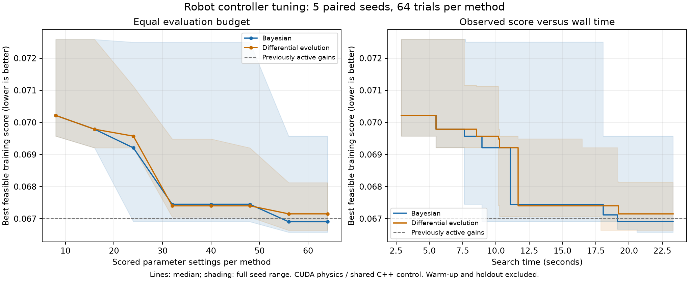

# Bayesian versus differential evolution: measured robot results

**Historical encoder-feedback experiment.** This controller used measurements
absent from the actual robot and does not validate its hardware. See the
[corrected IMU-only controller](imu-only-control.md). Results below retain their
original experimental context.

Measured on 2026-10-22 with the RTX 4060 Laptop GPU. **Differential evolution supplied the accepted controller at this 64-trial budget.** Bayesian found the slightly better training score, but its finalist failed a predicted peak-current check in independent Gazebo validation. A later [256-trial comparison](optimizer-comparison-256.md) extends the search and records the newer result.

The search results were close: Bayesian won 3 of five paired seeds and had a 0.37% lower median training score. Search times were essentially equal. This experiment does not establish a universal optimizer winner.



## Same-budget search results

Lower scores are better. Each method received **64 scored parameter settings per seed**, across **five seeds**.

| Measurement | Bayesian | Differential evolution |
| --- | ---: | ---: |
| Best training score | 0.06657568 | 0.06663748 |
| Median best training score | 0.06690435 | 0.06715038 |
| Mean best training score | 0.06743368 | 0.06727278 |
| Median search time | 21.80 s | 21.75 s |
| Selected controllers passing GPU holdout | 5/5 | 5/5 |
| Median holdout score | 0.04392776 | 0.04371073 |

| Paired seed | Bayesian training score | DE training score | Lower score |
| --- | ---: | ---: | --- |
| 7 | 0.06666739 | 0.06812314 | Bayesian |
| 42 | 0.06957209 | 0.06705199 | Differential evolution |
| 123 | 0.06657568 | 0.06715038 | Bayesian |
| 20261021 | 0.06690435 | 0.06740092 | Bayesian |
| 20261022 | 0.06744888 | 0.06663748 | Differential evolution |

The overlapping ranges in the plot matter: differences between seeds exceed the small difference between the two medians. DE had the better mean training score, while Bayesian had the better median and single best training result. Holdout scores were never used to choose either finalist.

## Independent Gazebo checks

Each method's lowest feasible training-score controller was selected across its five runs, then checked at +/-5 and +/-10 degrees for 12 simulated seconds per case.

| Finalist check | Bayesian, seed 123 | DE, seed 20261022 |
| --- | ---: | ---: |
| Recovery/position/speed response checks | 4/4 pass | 4/4 pass |
| Existing electrical prediction checks | 3/4 pass | 4/4 pass |
| Largest predicted PWM-on current | 1.210889 A | 1.194158 A |
| Default round trip | Skipped after rejection | Pass, 34.165 simulated seconds |

The Bayesian finalist recovered, but its -10-degree case predicted **1.210889 A** on-current against the existing **1.2 A model threshold**. Its average-current peak was 0.436860 A. It was rejected under the same checks used by automatic optimization updates; this is a model prediction, not measured hardware current.

The DE finalist passed all nominal acceptance checks and the full movement routine. Independent world poses measured legs of **0.496500 m** and **0.496872 m**, with a **0.3285-degree** half-turn error. Its predicted on-current was close to the threshold too, so these checks do not establish a large robustness margin or hardware rating compliance.

It uses Kp **0.57982590**, Kd **0.02674738**, position gain **0.31142919** and velocity gain **0.35822991**, with the unchanged 0.040 N m combined request cap. These four gains were automatically written to the active `balance.yaml`; other motion/actuator settings were preserved and a backup was saved in the run folder.

## Reproducible protocol

- Both methods used the same shared C++ controller, MuJoCo Warp physics, four-dimensional bounds, score, torque cap, body geometry and actuator model.
- Both started from the same pre-tuning gains (1.0, 0.10, 0.15, 0.35), with the same scrambled Sobol population of 16 points for each paired seed. Today's already-tuned active profile was measured separately and was not injected into either search.
- The 16 initial observations were evaluated once per seed and shared, giving both methods exactly the same initial data. Their measured initialization time was charged to both methods. There were 640 credited observations across the comparison and 560 actual search parameter evaluations, excluding warm-up and the active-profile reference check.
- Bayesian used the existing Gaussian-process Matern-5/2 / expected-improvement implementation for six further batches of eight.
- SciPy DE used 16 population members and three generations after initialization: `best1bin`, mutation dithering 0.5-1.0, crossover 0.7, deferred updates, vectorized population evaluation and no polishing. All population evaluations used the same eight-candidate GPU batches as Bayesian.
- Execution order alternated between methods across seeds. One GPU worker ran them sequentially. Timings include proposal computation, transfers, resets, physics, scoring and trial-record writing; warm-up, heldout tests and Gazebo are excluded.
- Training had eight initial states over eight simulated seconds. Six held-out states ran for 12 seconds after selection. The objective and feasibility gates are documented in [the optimization guide](gpu-optimization.md).
- The winner was the lowest training-score finalist passing independent checks and no worse than the previously active reference. Gazebo and heldout scores were not ranking criteria.

A further audit reevaluated both fixed finalists and the old active profile in all six three-profile batch orderings. Both finalists passed every repeat; Bayesian's median training score remained lower (0.06660063 versus 0.06666929). This confirms the small search-score difference without changing the rejection of its Gazebo electrical prediction. The repeat audit did not retune or select gains.

## Run it again

From the repository root in the Ubuntu/WSL terminal:

```bash
bash compare_optimizers.sh --check-shuttle
```

Default behavior validates both finalists and updates the normal menu to the best eligible result. `--check-shuttle` adds the default round-trip check; omit it for custom movement routines. `--search-only` preserves both candidates without Gazebo or an active update. Use a fresh output folder for each comparison. The completed raw run is `outputs/optimizer-comparison-20261022`.

The algorithms are implemented in [search_comparison.py](../gpu/search_comparison.py), using [the existing CUDA evaluator](../gpu/bayes_search.py). The comparison runner is [compare_optimizers.py](../gpu/compare_optimizers.py), and [the finalizer](../analysis/finalize_optimizer_comparison.py) handles independent checks and selection. CPU tests verify equal budgets, paired initialization, immutable shared observations and rejection of failed finalists. All 78 Python tests and the portable C++ checks passed.

[Selected results and source hashes](../experiments/optimizer-comparison-20261022.json), [Bayesian finalist](../experiments/optimizer-comparison-bayesian-20261022.yaml), [DE finalist](../experiments/optimizer-comparison-differential_evolution-20261022.yaml), and [exportable SVG plot](images/optimizer-comparison-20261022.svg) are saved for the portfolio.

## Limits

This is a five-seed result for a **64-trial budget**, fixed nominal model and specific objective. DE gets only three generations; a larger budget or different settings could change the ranking. These are simulation gains using wheel feedback, which your encoder-free Nano does not provide. Sensors, transport and actuator uncertainty remain incompletely modeled, and electrical diagnostics do not establish real L293D pulse or thermal compliance. Neither method proves global optimality or hardware stability.

Algorithm references: [SciPy differential evolution](https://docs.scipy.org/doc/scipy/reference/generated/scipy.optimize.differential_evolution.html), [Gaussian-process Bayesian optimization](https://proceedings.neurips.cc/paper_files/paper/2012/file/05311655a15b75fab86956663e1819cd-Paper.pdf).
