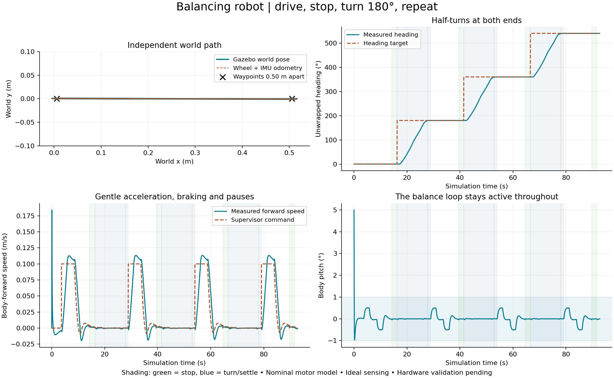

# Drive, stop, turn 180 degrees, repeat

This ROS/Gazebo demo keeps the balance controller active while a supervisor
repeats a motion sequence between two waypoints 0.50 m apart. The forward
cruise-speed target is 0.25 m/s (25 cm/s). It turns at both ends, so it returns along
the same path instead of continuing away from the starting point.
The turn-speed target is 50 degrees/s (0.873 rad/s), with the existing
0.35 rad/s² acceleration limit and gradual braking near the target heading.

## Run

From the repository root in the VS Code Ubuntu/WSL terminal:

```bash
bash run_shuttle.sh
```

The script builds the package, opens Gazebo, recovers from the initial
5-degree lean, waits for balance to settle, and starts the repeating routine.
Stop with Ctrl+C in the launch terminal or close Gazebo.

Optional arguments:

```bash
bash run_shuttle.sh distance_m:=0.50 speed_m_s:=0.25
bash run_shuttle.sh cycles:=1
```

`cycles:=1` performs one outward leg and one return leg, then stays balancing
at the final stop. `cycles:=0`, the default, repeats until stopped. Every next
leg is preceded by a half-turn. For the stationary balancing demo, continue
to use `bash run_gazebo.sh`.

## How it works

```text
WAIT_BALANCE -> DRIVE -> STOP -> TURN -> TURN_SETTLE -> DRIVE -> ...
                          |
                   DONE after requested cycles
```

1. The supervisor waits for quiet balance for two continuous seconds.
2. It publishes a forward-speed reference and monitors progress toward the
   next waypoint, slowing near that waypoint.
3. It holds near the endpoint until position and motion settle, then pauses.
4. It commands a 180-degree heading change while keeping the turning center
   near the endpoint. After the turn settles, the next forward leg returns
   toward the other waypoint.

The inner pitch PD and outer position/velocity feedback remain active in
every phase. The outer loop follows a moving position reference and a
slew-limited speed reference. Command acceleration is limited to 0.15 m/s².
The speed is a target, not an exact measured speed limit: initial balance
recovery and tracking transients can move the wheels faster.
The forward acceleration/braking ramp was raised from 0.05 to 0.15 m/s²
to start moving more promptly. The two-second settled-balance wait remains.

A yaw-rate PI controller creates a right-minus-left torque difference.
Its integral term provides sustained steering effort against tire/contact
resistance. Integration stops when steering runs out of available torque
headroom. Balance gets priority: steering can only use the remaining portion
of each wheel's +/-0.020 N m request allowance. These are software request
bounds, not physical current regulation.

Stopping means holding position with small balance corrections, rather than
turning the motors off. The default stop checks use a 5 mm projected position
band, forward speed below 0.01 m/s, yaw rate below 0.05 rad/s, pitch below
1 degree and pitch rate below 5 deg/s. A phase timeout stops the routine's
motion commands if progress stalls; balance remains active unless its own
fall/sensor fault has occurred.

## ROS interfaces and code

| Interface | Purpose |
| --- | --- |
| `/cmd_vel` (`geometry_msgs/Twist`) | Supervisor's forward-speed and yaw-rate requests |
| `/odom` (`nav_msgs/Odometry`) | Wheel/IMU pose and motion estimate |
| `odom -> base_link` TF | Estimated robot pose relative to its initial axle frame |
| `/shuttle/status` (`std_msgs/String`, JSON) | Phase transitions, completed legs and fault reason |
| `/shuttle/telemetry` | Phase, pose, speed, progress and commands for plotting |
| `/balance/fault` | Balance-controller fault reported to the supervisor |

`scripts/motion_core.py` contains the ROS-independent state machine, reference
ramps, odometry and torque allocation. `scripts/shuttle_demo.py` is the ROS
supervisor. `scripts/balance_controller.py` tracks its motion references while
balancing. Settings are in `config/balance.yaml`; distance, speed and cycle
launch arguments override the corresponding supervisor defaults.

The legacy `/balance/telemetry` position field measures signed wheel rolling
distance. When the robot turns around and drives forward again, that distance
continues increasing; world x/y are reported separately on `/odom`.

## Recorded nominal validation

With the updated 420 g, 15 x 10 x 3.5 cm body and measured wheel/axle geometry,
a fresh nominal round trip passed all recorded response checks
(`outputs/measured-geometry-shuttle-check`). The existing gains, 0.25 m/s target,
0.15 m/s² ramp and 50 degrees/s turn target were retained. The older records
below use the initial geometry. Hardware validation and geometry-specific
retuning remain separate work.

The current 0.15 m/s² ramp completed a one-round-trip Gazebo check on
2026-10-21 (`outputs/shuttle-accel015-check`) with the 0.25 m/s and 50 degrees/s
targets. All recorded response checks passed. Settled legs measured 0.4977 m
and 0.4961 m, with a 0.42-degree half-turn error. Measured speed reached
0.10 m/s about 1.04 s after DRIVE began, compared with 2.20 s in the earlier
0.05 m/s² run. Peak DRIVE speed was 0.286 m/s, illustrating tracking overshoot
above the 0.25 m/s target. All 50 unit checks pass. This is a nominal simulation
check; the earlier hardware/model validation limits still apply.

The 0.25 m/s and 50 degrees/s targets with the earlier 0.05 m/s² ramp completed a one-round-trip Gazebo
check on 2026-10-21 (`outputs/shuttle-turn50-check`). All recorded response
checks passed: settled legs measured 0.4981 m and 0.4963 m, and the half-turn
error was 0.40 degrees. Peak measured yaw rate reached 56.2 degrees/s, so the
50 degrees/s command is a target rather than a hard limit on actual rotation.
All 50 unit checks pass.

The 0.25 m/s target with the earlier 20 degrees/s turn target completed a one-round-trip Gazebo check on
2026-10-21 (`outputs/shuttle-speed025-check`). Both legs passed the distance,
turn, upright and torque-request checks, measuring 0.4982 m and 0.4964 m.
Peak measured forward speed during DRIVE was 0.178 m/s: the short legs and
acceleration/braking limits prevent reaching the cruise target. All 50 unit
checks pass. The following plot and two-round-trip results retain the earlier
0.10 m/s experiment.

Recorded 2026-10-21 at the earlier 0.10 m/s target with ROS 2 Jazzy / Gazebo Harmonic 8.15.0 under WSL2.
Two finite round trips completed in about 92 simulated seconds, including
initial recovery, four straight legs, four settled stops and three half-turns.
An endless run performs another turn after the fourth stop and continues.



| Measurement from independent Gazebo world poses | Recorded result |
| --- | --- |
| Straight-leg distances after settled stops | 0.4979, 0.4961, 0.4961, 0.4962 m |
| Absolute error from a 180-degree turn | 0.165, 0.073, 0.053 degrees |
| Return-position error after two round trips | 2.09 mm |
| Maximum cross-track displacement | 1.41 mm |
| Average motion in the final 0.25 s of each stop | Below 0.9 mm/s |
| Translation during each turn | Below 0.83 mm |
| Peak estimated average motor current | 0.383 A per motor |

The run passes the recorded sequence, distance, half-turn, upright and wheel
request-cap checks. Post-processing independently checks closure, cross-track
displacement, stopped motion, turning-center drift and pose coverage. All
**50 unit checks** pass. A fresh balance-only nominal +5-degree run also passes.
Processes stop cleanly after the recorder finishes.

The [selected machine-readable results](images/shuttle-demo.json) preserve
measurements, checks and source hashes. Earlier stalled-turn trials are kept
under `outputs/`; one trial's source/install mismatch is explicitly annotated.
The current checker rejects stale installed executable copies before running
and snapshots both source and actually installed code.

## Reproduce and inspect

Build first, then run a finite headless recording in a sourced WSL terminal:

```bash
source /opt/ros/jazzy/setup.bash
cd ros2_ws
colcon build --symlink-install --packages-select balancing_robot_sim
source install/setup.bash
cd ..
python3 analysis/check_shuttle.py --cycles 2 --speed 0.25 --output outputs/my-shuttle-check
python3 analysis/plot_shuttle.py outputs/my-shuttle-check --output docs/images/my-shuttle.png
```

The checker isolates its ROS domain and Gazebo transport partition, records
ROS telemetry and native Gazebo model poses, and saves source snapshots, logs,
CSV, phase transitions and a summary. It reads independent world poses through
`gz topic` JSON and retains entity names so wheel odometry is not used to
validate itself. Choose a fresh output directory for each trial.

To inspect a graphical run from another normally sourced terminal:

```bash
ros2 topic echo /shuttle/status
ros2 topic echo /cmd_vel
```

## Scope

These measurements are a nominal simulation demonstration, not evidence of
the same precision on the physical robot. Wheel sensing and IMU orientation
are ideal; wheel slip, long-term odometry/yaw drift, sensor estimation and
uncertain actuator properties limit real operation. The physical hardware
does not yet have confirmed wheel encoders. Electrical PWM-pulse compliance
remains unestablished even when average current is below the reference rating.
The previously documented deadband and weak-battery balance limitations remain.
